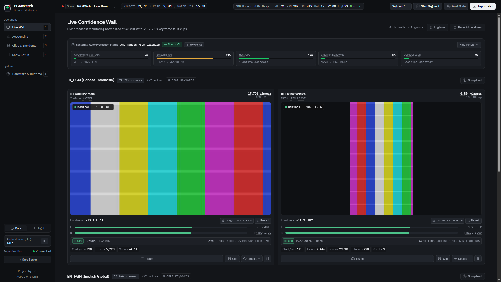
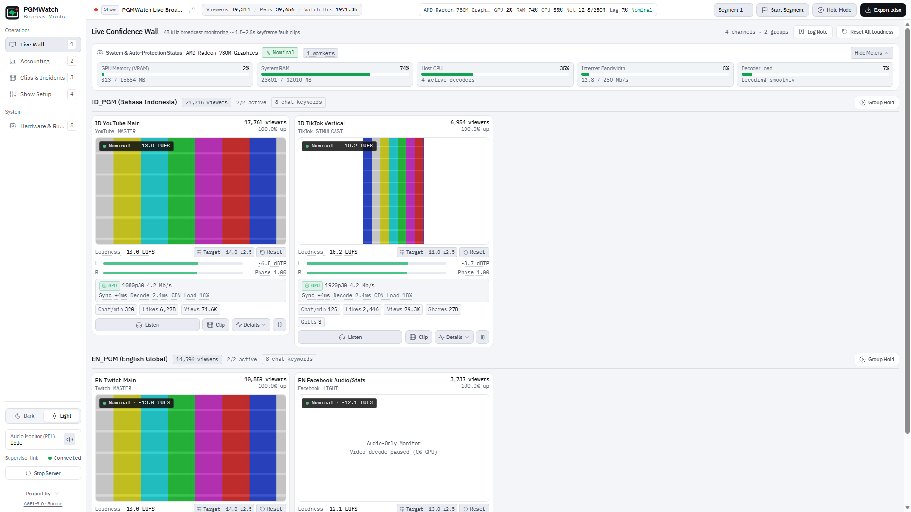
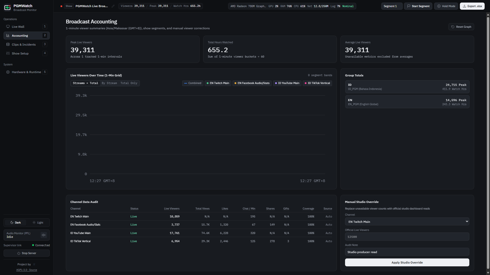
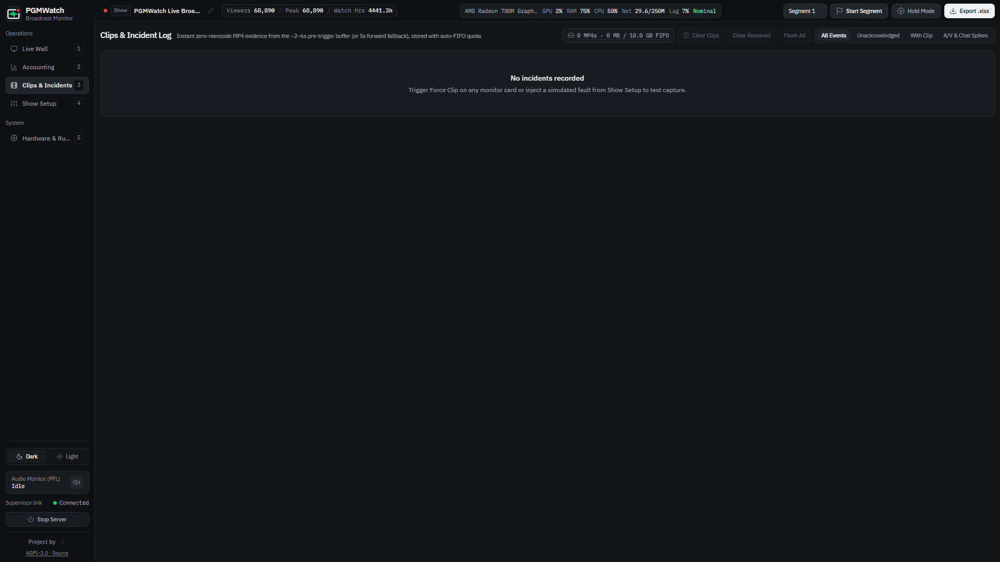
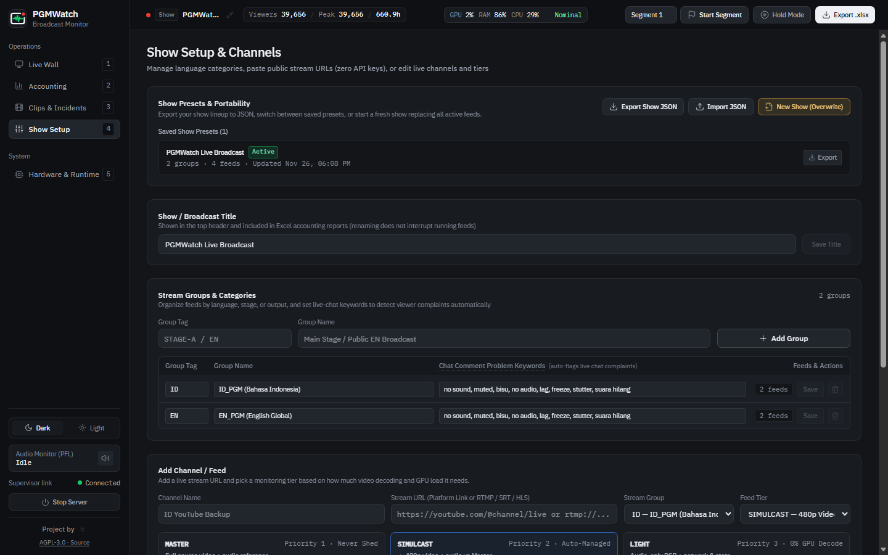
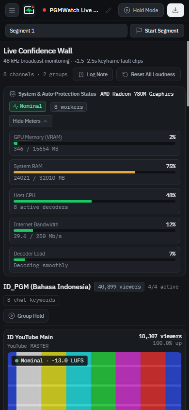

# PGMWatch

<p align="center">
  
</p>

<p align="center">
  <strong>Local-First Windows Broadcast Confidence Monitor, 48 kHz Audio DSP, Automated GOP Evidence & Stream Accounting Desk</strong>
</p>

<p align="center">
  <a href="LICENSE"></a>
  
  
  
  
</p>

---

<p align="center">
  
</p>

<p align="center">
  <em>PGMWatch Live Confidence Wall — Multi-language program feeds with 1.5 FPS / 60p HQ toggle, 48 kHz EBU R128 loudness & stereo VU meters, and live host GPU/RAM/WAN governor telemetry.</em>
</p>

<p align="center">
  <a href="#interface-showcase">Interface Showcase</a> •
  <a href="#overview">Overview</a> •
  <a href="#key-features">Key Features</a> •
  <a href="#directory-structure">Directory Structure</a> •
  <a href="#portable-runtime-quick-start">Quick Start</a> •
  <a href="#building-testing--packaging-from-source">Build from Source</a> •
  <a href="#launch-monitoring--rollback-runbook">Operations Runbook</a>
</p>

---

> [!WARNING]
> **AI Development Disclaimer:** This project contains AI-assisted code. It was designed, architected, and built with the assistance of an advanced AI coding agent. If an AI-assisted project does not align with your preferences or workflow requirements, you are welcome to review, fork, or modify the source code.

---

## Interface Showcase

### Studio Dark & Light Themes

| Studio Dark Theme (Default) | Studio Light Theme (Daylight / Venue) |
| :---: | :---: |
|  |  |
| **Live Confidence Wall (Dark)**: Tuned for dark broadcast control rooms with live GPU VRAM, system RAM, WAN, and decoder load meters plus 1-click **Live 60p** toggles. | **Live Confidence Wall (Light)**: High-contrast daylight theme for outdoor OB vans and bright production desks. |

### Broadcast Accounting, Clips & Show Presets

| Broadcast Accounting (1-Min UTC Grid) | Clips & Incident Log |
| :---: | :---: |
|  |  |
| **1-Minute UTC Accounting**: Tracks live viewers, peak viewers, watch hours, segment bands, manual studio overrides, and 4-tab `.xlsx` export. | **Automated Fault Evidence**: Logs every escalation with severity, duration, FIFO disk quota meter, and in-browser `.mp4` replay. |

| Show Presets & Stream Setup | Mobile / Tablet Confidence View |
| :---: | :---: |
|  |  |
| **Show Presets & Setup**: Export/import Show JSON presets, switch shows safely between segments, manage language groups, and configure feed tiers. | **Responsive Operations**: Full telemetry, hold mode, and channel cards adapt cleanly to narrow tablet and phone screens. |

---

## Overview

Broadcast control rooms and live-event producers often monitor dozens of concurrent public simulcasts (YouTube, Twitch, TikTok, Facebook, and custom RTMP/HLS/SRT feeds) across multiple language groups. Relying on browser tabs or ad-hoc media players wastes GPU/VRAM, misses brief audio/video dropouts, and provides no structured viewer accounting or evidence capture.

**PGMWatch** solves this with a local-first, single-machine Windows supervisor + isolated per-channel worker architecture:
1. **Isolated Per-Channel Workers (`pgmwatch-worker.exe`)**: Each stream runs in its own OS process under a Windows Job Object, decoding audio at 48 kHz and video via **FFmpeg 9.0 LGPL FFI (`D3D11VA`)** across NVIDIA, AMD, and Intel GPUs—or dropping cleanly to `LIGHT` CPU-only mode (`0%` GPU) when needed.
2. **Central Supervisor & Web UI (`PGMWatch.exe`)**: Serves the React/TypeScript operator console on `http://127.0.0.1:8787`, orchestrates URL resolution (`Streamlink`, `yt-dlp`, Edge CDP), streams WebSocket telemetry + 48 kHz PFL audio + fragmented MP4 (`fMP4`) 60p MSE video, and persists accounting/incidents to SQLite WAL.
3. **Deterministic Signal Analysis**: All audio DSP, video SIMD, bitrate collapse detection, and hysteresis state machines are deterministic, CPU/GPU-native algorithms with zero cloud dependencies.

---

## Key Features

### Live Confidence Wall & Monitoring Tiers
* **Three Monitoring Tiers (`MASTER`, `SIMULCAST`, `LIGHT`)**:
  * **`MASTER`**: Full hardware-accelerated video + 48 kHz audio DSP, 1.5 FPS thumbnails, and on-demand 60p MSE live preview.
  * **`SIMULCAST`**: Hardware-accelerated secondary feeds eligible for automatic Stage 2 governor demotion under heavy load.
  * **`LIGHT`**: Audio-only decode (`0%` GPU) while preserving 48 kHz loudness/hum/dead-air DSP, 5-second clips, and viewer accounting.
* **1-Click 60p HQ vs. Thumbnail Toggle**: Switch individual cards, entire language groups, or the whole wall between `1.5 FPS` thumbnails and live `60p` fragmented-MP4 (`MSE`) video.
* **Sample-Accurate 0 ms Listen (PFL) Monitoring**: Solo any feed in the browser using either muxed MSE audio (when 60p HQ is active) or low-latency WebSocket PCM, backed by a shared Web Audio `AudioContext` and 30 fps stereo RMS metering.

### Audio DSP, Video SIMD & Automated Evidence Clips
* **48 kHz Audio DSP**: Measures short-term & integrated loudness (`LUFS`), true peak (`dBTP`), stereo phase correlation, **Dead Air**, **Audio Clipping**, **50/60 Hz Mains Hum**, and **Wrong Program / Language Bus** mismatch against group reference loudness.
* **Video & Transport Telemetry**: Detects **Black Frame**, **Frozen Video** (ignoring static UI overlays via block-level MAD), **A/V Sync Drift**, **Bitrate Collapse** (with static-scene VBR awareness), manifest ad-break markers, and **Live Chat Complaint Spikes**.
* **5-Second GOP Evidence Clips**: Maintains an in-memory pre-trigger IDR ring buffer per channel and automatically writes H.264/AAC `.mp4` evidence clips on fault escalation (plus manual **Clip** capture), quota-managed via FIFO cleanup (`clip_quota_gb`).

### Broadcast Accounting & Multi-Show Presets
* **60-Second UTC Grid & Segment Slicing**: Records per-minute `CCV`, `PCV`, `Hours Watched`, views, likes, chat rate, shares, and gifts with optional encoding-delay alignment and **Manual Studio Overrides** for `UNAVAILABLE` feeds.
* **4-Tab `.xlsx` Report Export**: One-click export (`GET /api/export.xlsx`) containing `Executive Summary`, `Match Breakdown`, `Platform Accounting`, and `Health & Incident Log`.
* **Show Preset Management**: Export current shows to JSON, import presets, switch between saved shows, or create a clean new show (guarded whenever a broadcast segment is actively recording).

### Resource Governor & Production Guardrails
* **WDDM System-Wide VRAM & Host Telemetry**: Queries system-wide adapter memory via `gdi32!D3DKMTQueryStatistics`, DXGI adapter LUIDs, host RAM, WAN ingest (`Mb/s`), and max decode latency.
* **Two-Stage Automatic Degradation**:
  * **Stage 1 (`VRAM >= 80%` or `Decode Latency >= 85%`)**: Throttles thumbnails from `1.5 FPS` to `0.5 FPS`.
  * **Stage 2 (`VRAM >= 88%` or `Decode Latency >= 100%`)**: Demotes lowest-priority `SIMULCAST` feeds to `LIGHT` (`0%` GPU).
* **Anti-Bootloop Breaker & Job Guard**: Locks any worker that hits 2 GPU faults in 60 seconds into `LIGHT` CPU mode, and binds all child processes (`pgmwatch-worker.exe`, `ffmpeg.exe`, extractors) to a Windows Job Object so closing `PGMWatch.exe` cleans up everything cleanly.

### Integrations
* **Bitfocus Companion Module (`companion-module-pgmwatch/`)**: WebSocket control module for Stream Deck / tally / Hold Mode / 5s clips / PFL workflows. Point Companion's **Settings → Developer modules path** to the parent folder containing `companion-module-pgmwatch/` (default host `127.0.0.1`, port `8787`) — channel & group dropdowns, variables, and button presets populate automatically on connect.
* **TikTok LIVE Stats Sidecar (`sidecar-stats/`)**: Node.js viewer-mode connector for real-time TikTok concurrent viewers, likes, shares, and gifts.

---

## Directory Structure

```text
PGMWatch/
├── Cargo.toml                        # Rust 2024 workspace manifest
├── Cargo.lock                        # Locked Rust dependency graph
├── pgmwatch.toml                     # Default runtime configuration
├── Logo.jpg                          # PGMWatch application icon
├── .cargo/
│   └── config.toml                   # Windows MSVC static CRT configuration
├── crates/
│   ├── pgmwatch-core/                # Shared models, SQLite WAL DB, 60s grid, XLSX export, IPC
│   ├── pgmwatch-worker/              # Isolated per-channel media worker (FFmpeg 9.0 FFI, DSP, SIMD, GOP ring)
│   └── pgmwatch-supervisor/          # Axum HTTP/WS server, MSE fMP4 hub, URL resolver, governor, tray UI
├── ui/                               # React 19 + TypeScript 5.7 + Tailwind CSS v4 operator console
├── companion-module-pgmwatch/        # Bitfocus Companion WebSocket module
├── sidecar-stats/                    # TikTok LIVE viewer-mode stats sidecar
├── scripts/
│   ├── test.ps1                      # Workspace test runner (with FFmpeg 9.0 FFI)
│   ├── build.ps1                     # UI, Companion & Rust build script
│   └── package-portable.ps1          # Portable ZIP & dist/PGMWatch bundler
└── docs/
    ├── screenshots/                  # Verified UI captures used in documentation
    └── ideas/                        # Architecture & design notes
```

---

## Portable Runtime Quick Start

Extract `dist/PGMWatch-Portable.zip` (or run directly from `dist/PGMWatch/`):

1. Double-click `PGMWatch.exe` to open the **PGMWatch Server Control** launcher window (with **Open Web UI**, **Hide to Tray**, and **Stop Server** buttons plus a system tray menu) and automatically open `http://127.0.0.1:8787` in your browser.
   * Set `PGMWATCH_NO_BROWSER=1` (or `open_browser_on_start = false` in `pgmwatch.toml`) to skip auto-opening the browser.
   * Pass `--headless` (or set `PGMWATCH_HEADLESS=1`) for headless CLI / service runs without the desktop launcher window.
   * Logs are written to `data\pgmwatch.log` (capped to 5 MB on startup).
2. Keyboard navigation in the UI:
   * `1` — Live Confidence Wall
   * `2` — Broadcast Accounting (60s UTC Grid & Manual Overrides)
   * `3` — Clips & Incident Log (5s `.mp4` evidence replay)
   * `4` — Show Setup, Presets & Simulator Fault Injection
   * `5` — Hardware & Runtime Settings (`pgmwatch.toml`)
   * `Escape` — Close clip modal
   * Theme switcher (`Dark` / `Light`) and `Stop Server` are in the bottom-left sidebar.
3. Health endpoint: `GET http://127.0.0.1:8787/api/health`
4. One-click Excel export: `GET http://127.0.0.1:8787/api/export.xlsx`

---

## Configuration (`pgmwatch.toml`)

* **`[server]`**: `bind_host`, `port` (`8787`), `open_browser_on_start`, `outbound_bind_ip` (bind monitoring ingress off Dante / production NICs).
* **`[media]`**: `gpu_mode` (`auto` | `d3d11va` | `cli_ffmpeg` | `cpu_light`), `master_gpu_luid`, `simulcast_gpu_luid`, `extra_hw_frames` (`6`), `thumbnail_fps` (`1.5`), `clip_quota_gb` (`10.0`).
* **`[governor]`**: VRAM/RAM/WAN admission caps (`75%` / `92%` / `85%`), Stage 1 & Stage 2 degradation thresholds, `worker_memory_limit_mb` (`512`).
* **`[extraction]`**: `auth_mode` (`"anonymous"` | `"fallback_auth"`), `max_concurrent_extractors` (`6`), `enable_bgutil_pot`, `bgutil_pot_port` (`4416`), `msedge_path`.
* **`[alerts]`**: `recovery_hysteresis_secs` (`3`), `critical_escalation_secs` (`5`), `clip_cooldown_secs` (`30`), `chat_spike_unique_viewers` (`10`), `chat_spike_window_secs` (`15`).
* **`[storage]`**: `data_dir` (`"data"`), `db_batch_interval_ms` (`1000`).

---

## Building, Testing & Packaging from Source

Requires **Windows 10/11 (x64)**, **Visual Studio 2022 MSVC**, **LLVM (`libclang.dll`)**, **Rust 1.98+**, **Node.js (v20+)**, **pnpm**, and a local **FFmpeg 9.0 LGPL shared kit** (`vendor/ffmpeg-9.0/`):

```powershell
# Run workspace unit tests (with FFmpeg 9.0 FFI)
powershell -ExecutionPolicy Bypass -File scripts/test.ps1

# Build UI, Companion module, and Rust binaries
powershell -ExecutionPolicy Bypass -File scripts/build.ps1 -WithFfmpegFfi

# Build release + assemble dist/PGMWatch/ and dist/PGMWatch-Portable.zip
powershell -ExecutionPolicy Bypass -File scripts/package-portable.ps1 -WithFfmpegFfi
```

---

## Launch Monitoring & Rollback Runbook

### Pre-Show Verification
1. Verify `GET /api/health` returns `{"status":"ok","db_ok":true}`.
2. Confirm DXGI GPU adapter detection in startup logs (`AMD` / `NVIDIA` / `Intel` LUIDs).
3. Test one **Clip** capture and confirm playback via `/clips/<filename>.mp4` plus **Export .xlsx**.

### Automatic & Manual Degradation / Rollback
* **Stage 1 Degradation (`VRAM >= 80%` or `Decode Latency >= 85%`)**: Thumbnails throttle automatically from `1.5 FPS` to `0.5 FPS`.
* **Stage 2 Degradation (`VRAM >= 88%` or `Decode Latency >= 100%`)**: Lowest-priority `SIMULCAST` channels demote to `LIGHT` (`0%` GPU decode while keeping 48 kHz audio DSP, 5s clips, and CCV accounting active).
* **Anti-Bootloop Breaker**: If any channel worker raises 2 GPU/driver faults within 60 seconds, it automatically respawns locked in `LIGHT` CPU-only mode.
* **Auth Profile Reset**: If an optional fallback burner login becomes stale, click **Wipe Auth** (`POST /api/channels/{id}/auth/wipe`) to clear `data/profiles/<platform>_auth/`.
* **Binary Rollback**: Retain the previous `PGMWatch-Portable.zip` archive; stop `PGMWatch.exe` (Windows Job Objects terminate all child workers automatically), swap executables/DLLs, and preserve `data/sentinel.db` (SQLite WAL).

---

## Author & Credits

* **Developed by:** Ballas43
* **Core Media & Extraction Stack:** Powered by [FFmpeg](https://ffmpeg.org/) (9.0 LGPL), [Streamlink](https://streamlink.github.io/), [yt-dlp](https://github.com/yt-dlp/yt-dlp), [Axum](https://github.com/tokio-rs/axum), [SQLx](https://github.com/launchbadge/sqlx), [React](https://react.dev/), [Bitfocus Companion](https://bitfocus.io/companion), and [`tiktok-live-connector`](https://github.com/zerodytrash/TikTok-Live-Connector).

---

## License

This project is licensed under the **GNU Affero General Public License v3.0 (AGPL-3.0)**. See [LICENSE](LICENSE) for the full license text and [THIRD_PARTY_NOTICES.txt](THIRD_PARTY_NOTICES.txt) for bundled dependency notices.
